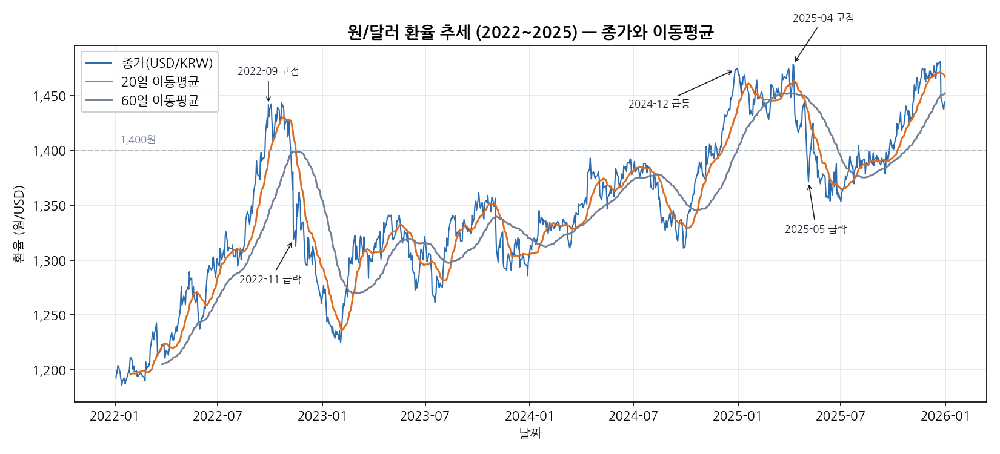
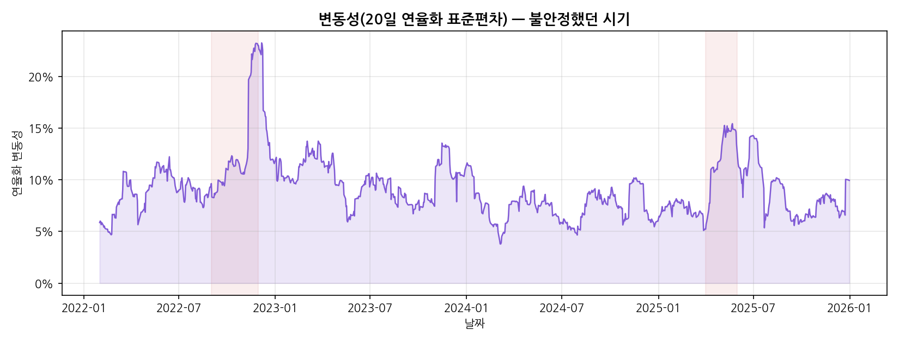
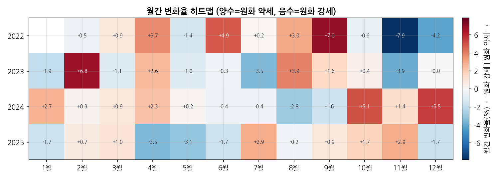

# USD/KRW 시계열 분석 (2022~2025)

원/달러 환율 4년치(약 1,023일)를 분석해서, 환율이 **어떤 방향으로 움직였고 / 언제 크게 흔들렸고 / 왜 그랬을지**를 그래프와 함께 정리한 프로젝트입니다.

**GitHub**: <https://github.com/QWERQWER-qwer/usdkrw-timeseries> · 분석 리포트 [REPORT.md](REPORT.md) · 발표·설명 노트 [EXPLAIN.md](EXPLAIN.md) · AI 사용 로그 [AI_USAGE_LOG.md](AI_USAGE_LOG.md)

> **먼저 알아둘 한 가지 — "환율이 오른다"는 무슨 뜻?**
> 원/달러 환율이 **1,200 → 1,400으로 오르면**, 1달러를 사는 데 원이 더 많이 든다는 뜻이라 **원화 가치는 오히려 떨어진 것**입니다. 이걸 "**원화 약세**"라고 불러요. 반대로 환율이 내려가면 "원화 강세". 이 문서에서 "환율 상승 = 원화 약세"로 읽으시면 됩니다.

## 배경 (왜 이걸 분석했나)

뉴스에는 "환율이 올랐다/내렸다"가 자주 나오지만, 그게 **한동안 쭉 이어지는 흐름(추세)**인지 아니면 **하루 이틀 반짝 튄 것**인지는 말만으로는 구분이 안 됩니다. 그래서 2022~2025년 매일의 환율을 직접 놓고 세 가지를 확인했습니다.

## 이 프로젝트가 답하려는 질문

1. 4년간 환율은 **한 방향으로 기울었나**, 아니면 오르내리기만 했나?
2. **크게 튄 날(급등·급락)**은 언제였고, 그때 무슨 일이 있었나?
3. **흔들림(변동성)이 심했던 시기**가 따로 있었나?

## 결과 미리보기 (그래프로 보는 요약)

### 1) 추세 — 4년간 원화는 약세로 기울었다


파란 선이 매일의 환율, 주황·회색 선은 **이동평균**입니다.

> **이동평균이란?** 최근 20일(또는 60일) 값을 평균 내서 이어 그린 선입니다. 매일 값은 들쭉날쭉해서 큰 흐름이 안 보이는데, 평균을 내면 **울퉁불퉁함이 지워지고 방향만 남아** 추세를 보기 쉬워집니다.

**읽는 법**: 시작(2022년 초) 약 1,193원에서 끝(2025년 말) 약 1,444원으로, 4년간 **약 +21% 올랐습니다(원화 약세)**. 짧게 오르내리긴 했지만 큰 방향은 우상향이었어요. 점선(1,400원)을 넘긴 날이 전체의 5분의 1이나 됩니다.

### 2) 변동성 — 흔들림은 늘 심한 게 아니라 특정 시기에 몰린다


> **변동성이란?** "요즘 환율이 얼마나 심하게 출렁이나"를 숫자로 만든 것입니다. 값이 높을수록 하루하루 움직임이 크다는 뜻이에요.

**읽는 법**: 평소엔 잔잔하다가 **2022년 하반기와 2025년 봄(색칠된 구간)에 뾰족하게 솟습니다.** 즉 위험은 항상 큰 게 아니라 몇몇 국면에 집중됩니다.

### 3) 월별로 보면 — 어떤 달에 오르고 내렸나


> **읽는 법**: 칸 하나가 "그 달에 환율이 몇 % 움직였나"입니다. **빨강=그 달에 원화 약세(환율 상승), 파랑=원화 강세(환율 하락)**. 예를 들어 2022년 11월은 진한 파랑(-7.9%)으로 그 달에 원화가 크게 강해졌고, 2024년 12월은 빨강(+5.5%)으로 원화가 급하게 약해졌습니다.

*(이 외에도 `images/` 폴더에 일간 변화율, 시계열 분해, 예측 그래프가 더 있습니다. 자세한 해석은 [REPORT.md](REPORT.md)에 있어요.)*

## 실행 방법

```bash
pip install -r requirements.txt
python make_dataset.py   # data/usdkrw_2022_2025.csv 생성 (인터넷 없이도 됨)
python analysis.py       # images/ 그래프 6개 + stats.json 생성
```

- 노트북으로 보려면 `analysis.ipynb`를 열고 위에서부터 순서대로 실행(Run All)하세요. 단, `make_dataset.py`를 먼저 한 번 돌려야 합니다.
- 분석의 자세한 해석·인사이트는 [REPORT.md](REPORT.md)에 정리돼 있습니다.

## 폴더 구조

```
usdkrw/
├── data/usdkrw_2022_2025.csv     # 분석에 쓴 데이터 (코드가 만들어 줌)
├── images/                        # 그래프 png 6개 (코드가 만들어 줌)
├── make_dataset.py                # 데이터 준비 (원본을 코드 안에 넣어둬 인터넷 없이 재현)
├── analysis.py                    # 데이터 정리 + 분석 + 그래프
├── analysis.ipynb                 # 위 파일의 노트북 버전 (내용 동일)
├── REPORT.md                      # 분석 리포트 (본문)
├── requirements.txt               # 필요한 라이브러리 목록
└── stats.json                     # 리포트에 쓴 핵심 숫자 (코드가 만들어 줌)
```

## 핵심 결정 (왜 이렇게 했나)

중요한 갈림길에만 이유를 붙였습니다.

- **데이터는 유럽중앙은행(ECB) 환율을 썼다.** 고를 때 기준은 "① 가입·키가 필요 없을 것 ② 수집이 끊기지 않을 것 ③ 인터넷 없이도 다시 돌아갈 것"이었습니다. 가장 유명한 Yahoo Finance는 서비스가 자주 바뀌어 수집이 끊기는 일이 있어 ②에서 걸렀고, ECB 방식은 세 가지를 모두 만족했습니다. 대신 국내 시장 종가와 아주 작은 차이가 있을 수 있다는 점은 아래 한계에 적었습니다.
- **주말·공휴일의 빈 날은 억지로 채우지 않았다.** 그날은 값이 "없는" 게 아니라 **거래를 안 한 날**이라, 없는 값을 만들어 넣으면 사실이 아닌 데이터가 되기 때문입니다.
- **튀는 값(이상치)을 지우지 않았다.** 하루에 크게 움직인 날들을 확인해보니 대부분 **실제로 큰 사건이 있던 날**이라, 오류가 아니라 중요한 정보라고 봤습니다.

## 한계 (한 것 / 못 한 것)

정직하게 밝혀둡니다.

- **(못 함)** 금리·물가·수급 같은 **바깥 요인은 반영하지 않았습니다.** 그래서 리포트의 "왜"는 모두 "그 시점에 이런 일이 있었다" 수준의 **추측**이지, 증명된 인과는 아닙니다.
- **(못 함)** 미래 예측은 아주 단순한 기준선(어제 값 유지 등)까지만 했고, 본격적인 예측 모델은 넣지 않았습니다.
- **(했지만 한계)** ECB 환율이라 국내 시장 종가와 소수점 수준 차이가 있을 수 있습니다.
- **(했지만 한계)** 이동평균·변동성은 "며칠 평균으로 볼지"에 따라 결과가 달라집니다. 여기서는 20일·60일로 정해 썼습니다.

## 데이터 출처 / 라이선스

유럽중앙은행(ECB) 기준환율을 오픈 API [Frankfurter](https://frankfurter.dev)로 조회했습니다(수집일 2026-09-30). ECB 환율은 출처만 밝히면 자유롭게 쓸 수 있고, 조회한 원본은 `make_dataset.py` 안에 넣어둬 인터넷 없이도 그대로 재현됩니다.
