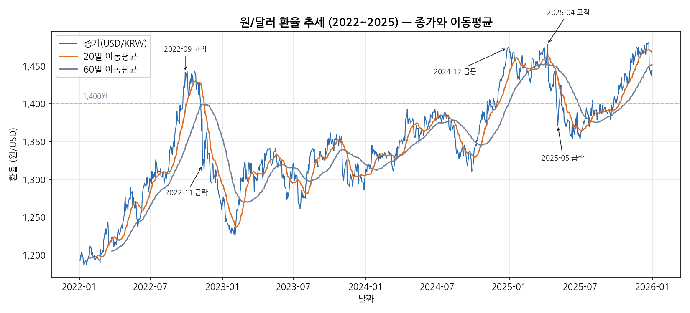
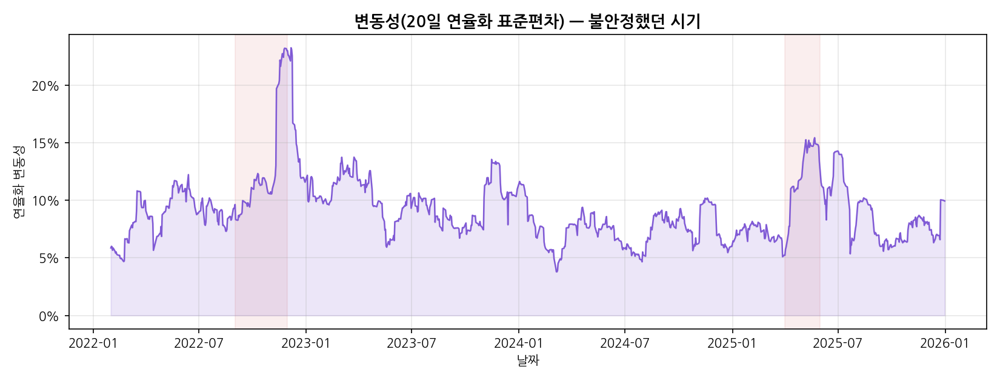
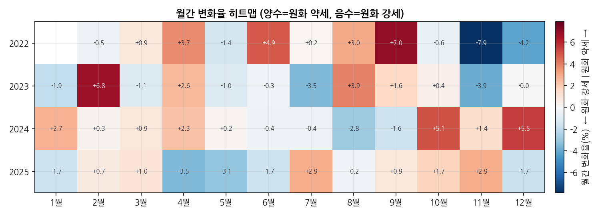
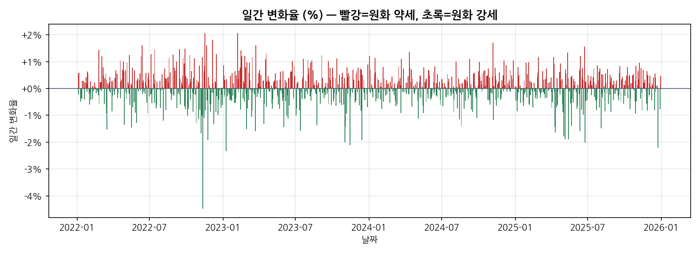
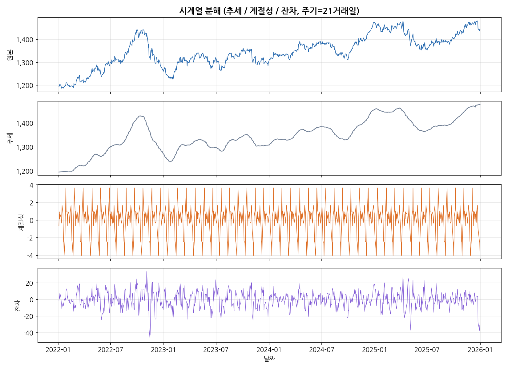
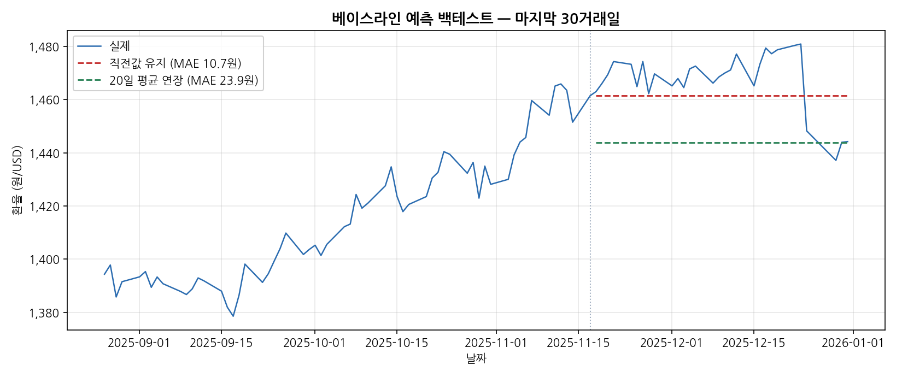

# 원/달러 환율 시계열 분석 리포트 (2022~2025)

## 1. 분석 주제 및 선정 이유

원/달러 환율은 수출입 기업의 채산성, 물가, 해외여행·유학 비용, 외국인 투자자금의 유출입까지
폭넓게 영향을 주는 지표다. 뉴스에서는 "환율이 올랐다/내렸다"가 자주 언급되지만, 그 흐름이
**추세적인 변화였는지, 일시적 급등락이었는지**는 숫자를 직접 봐야 구분할 수 있다.

그래서 이 리포트는 2022년부터 2025년까지 약 4년간의 일별 환율 데이터를 대상으로,
(1) 큰 추세가 있었는지, (2) 급등·급락 구간이 언제였는지, (3) 흔들림(변동성)이 특정 시기에
집중됐는지를 데이터로 확인한다. 이 기간은 미국의 급격한 금리 인상(2022), 강달러 장기화(2023~2024),
그리고 국내외 이벤트가 겹친 시기(2024 말~2025)가 포함되어 있어 "추세와 사건"을 함께 관찰하기에 적합하다.

## 2. 분석 질문

1. **Q1 (그래프로 확인)** 2022~2025년 전체적으로 원/달러 환율은 상승(원화 약세) 추세였는가, 아니면 등락만 반복했는가?
2. **Q2 (구간·이벤트)** 급등·급락 구간은 언제였고, 당시 거론된 대외 이벤트와 시점상 연결해 볼 수 있는가?
3. **Q3 (해석 필요)** 변동성이 특정 시기에 집중되었는가? 또 월(月) 단위로 반복되는 방향성(계절성 비슷한 패턴)이 있는가?

질문은 의도적으로 "그래프만 보면 답이 나오는 것(Q1)"과 "추가 해석이 필요한 것(Q2·Q3)"을 섞었다.
분석의 목적이 그래프 나열이 아니라 "그래서 무슨 의미인가"를 답하는 데 있기 때문이다.

## 3. 데이터 설명

- **출처**: 유럽중앙은행(ECB) 기준환율. 조회는 오픈 API인 Frankfurter(<https://frankfurter.dev>)를 사용.
- **대상/기간**: USD/KRW, 2022-01-03 ~ 2025-12-31.
- **데이터 수**: 1,023개(거래일 종가 기준).
- **컬럼**: `Date`(날짜, 인덱스), `Close`(1달러당 원화 값).
- **수집일**: 2026-09-30.
- **수집 방법**: 연도별 기간 조회로 JSON을 받아 `make_dataset.py`에 원본을 보존하고, 병합·정렬 후 CSV로 저장.
- **라이선스**: ECB 환율은 출처 표기 시 자유 이용 가능, Frankfurter는 무료/오픈 API.

> 지정된 한계(정직하게): ECB 기준환율은 매 영업일 유럽 시간 오후에 고시되는 **참고환율**이라,
> 국내 외환시장의 장중 고가/저가나 서울 외환시장 종가와는 소수 차이가 있을 수 있다.
> 본 분석은 "추세·구간·변동성"을 보는 것이 목적이므로 이 수준의 차이는 결론에 영향을 주지 않는다고 판단했다.

## 4. 데이터 정제 (기준과 근거)

- **결측치**: 병합 후 종가 결측 0개. 달력일 기준으로 값이 없는 날(주말·유로존 공휴일)은 약 440일이지만,
  이는 결측이 아니라 **비거래일**이다. 따라서 인위적으로 채우지 않고 "거래일 기준"으로 분석했다
  (시계열 금융 분석의 표준 관행이며, 이동평균·변화율도 거래일 기준으로 해석한다).
- **이상치**: 하루 ±2~4% 수준의 큰 변동일이 존재한다. 확인 결과 대부분 실제 시장 이벤트(예: 미국 물가지표 발표일)와
  맞물려 있어 **오류가 아니라 정보**로 판단했다. 따라서 제거하지 않고 유지하되, 변화율 기준으로
  어느 날이 극단적이었는지 따로 식별해 해석(Q2)에 활용했다.

즉 "채우기/제거"를 기본값으로 두지 않고, 데이터 성격(거래일·실제 이벤트)에 근거해 **유지**를 선택했다.

## 5. 분석 방법 (기법과 선택 이유)

| 기법 | 계산 | 왜 이 기법인가 | 답하는 질문 |
|---|---|---|---|
| 이동평균(20·60일) | `rolling(20/60).mean()` | 일별 노이즈를 걷어내고 단기(약 1개월)·중기(약 3개월) 추세를 본다 | Q1 |
| 일간 변화율 | `pct_change()` | 절대 수준이 아닌 상대적 등락으로 급변일을 식별 | Q2 |
| 변동성(20일 연율화 표준편차) | `ret.rolling(20).std()*√252` | 흔들림의 크기를 시계열로 만들어 불안정 시기를 탐지 | Q3 |
| 월별 집계·히트맵 | `resample('ME')`, 연×월 피벗 | 월 단위로 방향성이 반복되는지 확인 | Q3 |
| (보너스) 시계열 분해 | `seasonal_decompose` | 추세/계절성/잔차를 분리해 구조를 본다 | Q3 |
| (보너스) 베이스라인 예측 | 직전값 유지·20일 평균 연장 | 정확도가 아니라 "가정·한계"를 설명하기 위한 기준선 | — |

이동평균 창(20·60일)은 각각 "약 1개월/3개월"이라는 해석 가능한 기간이라 골랐다.
변동성은 표준편차에 √252(연 거래일 수)를 곱해 연율화해, 흔히 쓰는 "연 몇 %" 척도로 읽히게 했다.

## 6. 분석 결과 및 시각화

### 6-1. 추세 — 종가와 이동평균


**관찰**: 시작 1,192.78원(2022-01-03) → 종료 1,444.20원(2025-12-31)으로 **약 +21.1%** 상승(원화 약세).
20일선이 60일선 위에 머문 구간이 대부분이라 중기적으로도 상승 방향이 우세했다.
전 구간 최저 1,185.76원(2022-01-13), 최고 1,480.88원(2025-12-23).

### 6-2. 변동성 — 흔들림이 집중된 시기


**관찰**: 20일 연율화 변동성의 평균은 약 9.2%였고, **2022-12-06에 23.3%로 최고치**를 기록했다.
2022년 하반기와 2025년 봄에 변동성이 뚜렷하게 튀었다(음영 구간).

### 6-3. 월간 변화율 히트맵


**관찰**: 2022년 11월 -7.9%(원화 급강세), 2024년 12월 +5.5%(원화 급약세)처럼
월 단위 극단값이 존재한다. 월(1~12)별 평균으로 보면 9월(+2.0%)·2월(+1.8%)·10월(+1.7%)은
평균적으로 원화 약세, 11월(-1.9%)·5월(-1.3%)은 원화 강세 쪽이 잦았다.

### 6-4. 일간 변화율 분포


**관찰**: 최대 하락일은 2022-11-11의 **-4.47%**(원화 급강세), 최대 상승일은 2022-11-17의 +2.07%.
두 극단이 모두 2022년 11월에 몰려 있다.

## 7. 인사이트 (관찰 → 원인(가설) → 행동)

**인사이트 1 — "4년은 한 방향(원화 약세)으로 기운 구간이었다."**
- 관찰(Fact): 전 구간 +21.1%, 연평균값이 1,293원(2022) → 1,307(2023) → 1,364(2024) → 1,422(2025)로 매년 상승. 1,400원 이상에서 거래된 날이 전체의 **20.7%**.
- 원인(Why, 가설): 미국의 고금리 장기화로 인한 강달러 환경이 배경으로 거론된다. 다만 데이터만으로 인과를 단정할 수는 없다.
- 행동(Action): "환율이 다시 1,200원대로 내려간다"는 전제보다, 높은 레벨이 일정 기간 유지될 가능성을 기본 시나리오로 두고 대응(예: 수입 비용·해외지출 가정)을 점검.

**인사이트 2 — "급락은 특정 이벤트 하루에 몰린다."**
- 관찰(Fact): 최대 하락일 2022-11-11 하루에 -4.47%. 반대로 급등은 2024년 12월·2025년 4월 구간에 집중.
- 원인(Why, 가설): 2022-11-11은 미국 소비자물가(CPI)가 예상보다 낮게 나온 날과 시점이 겹친다(달러 급락 → 원화 강세). 2024년 말·2025년 봄의 급등 구간은 국내외 정치·통상 이슈가 거론된 시기와 겹친다. 모두 "시점 일치"이지 증명된 인과는 아니다.
- 행동(Action): 환헤지·환전 타이밍을 잡을 때, 주요 지표 발표일(미국 CPI·FOMC 등) 전후의 하루 변동을 별도 리스크로 관리.

**인사이트 3 — "변동성은 상시 높은 게 아니라 특정 국면에 몰린다."**
- 관찰(Fact): 변동성 평균 9.2%인데 2022-12-06엔 23.3%까지 치솟음. 2022년 하반기, 2025년 봄에 집중.
- 원인(Why, 가설): 방향이 급하게 바뀌는 국면(추세 전환기)에서 변동성이 커지는 것으로 보인다.
- 행동(Action): 변동성이 낮은 구간과 높은 구간을 구분해, 높은 구간에서는 한 번에 큰 금액을 환전하기보다 분할하는 식으로 리스크를 낮추는 전략을 고려.

## 8. (보너스) 시계열 분해와 베이스라인 예측

### 8-1. 시계열 분해


추세 성분은 6-1의 관찰(장기 우상향)을 다시 확인해준다. 21거래일(약 1개월) 주기로 분해했을 때
계절성 성분의 크기는 추세 변화에 비해 작아, **이 데이터의 움직임은 계절성보다 추세·불규칙(사건성) 요인이 주도**한다고 읽었다.

### 8-2. 베이스라인 예측(백테스트)


마지막 30거래일을 검증 구간으로 두고 두 가지 단순 기준선을 비교했다.
- 직전값 유지: 평균절대오차(MAE) **약 10.7원**
- 20일 평균 연장: MAE 약 23.9원

**해석과 한계(중요)**: 여기서 목적은 정확한 예측이 아니라 "기준선이 얼마나 맞는지"를 보는 것이다.
직전값 유지가 더 나았던 이유는 환율이 임의보행(random walk)에 가까워 "어제와 비슷"이 강한 기준선이기 때문이다.
이 결과는 **단기·특정 구간 한정**이며, 대외 변수를 전혀 반영하지 않으므로 실제 예측 용도로는 쓸 수 없다.

## 9. 결론 및 한계점

**결론**: 2022~2025년 원/달러 환율은 **추세적으로 원화 약세(상승) 방향**이었고, 급락·급등과 높은 변동성은
소수의 이벤트 구간에 집중되었다. 월별로 약한 방향성 경향은 보이지만, 전체 움직임은 계절성보다
추세와 사건성 요인이 더 크게 좌우했다.

**한계점(구현/미구현으로 구분)**
- (미구현) 금리차·물가·주가·수급 등 **외부 변수를 반영하지 않았다**. 원인은 모두 "시점 일치"에 기반한 가설이다.
- (미구현) 예측은 베이스라인 수준이며, 통계·머신러닝 모델은 적용하지 않았다.
- (구현·한계 명시) 데이터는 ECB 참고환율이라 서울 외환시장 종가와 소수 차이가 있을 수 있다.
- (구현·한계 명시) 변동성·이동평균은 창(window) 길이 선택에 따라 민감하다. 20·60일은 해석 편의로 고정했다.

## 10. AI 사용 로그 (투명성)

1. **사용한 작업**: 데이터 수집 스크립트 작성, 데이터 정제·시계열 지표 계산 코드, 시각화(그래프 6종),
   리포트 초안 문장 다듬기.
2. **사용 이유**: 반복적인 전처리·시각화 코드의 시간 절감과, 분석 기법 선택지(이동평균·변동성·분해·베이스라인 예측) 탐색.
3. **검증 방법**:
   - 핵심 수치(시작/종료/최고/최저/연도별 변화율)를 `stats.json`으로 따로 출력해 그래프와 교차 확인.
   - 급등·급락일(2022-11-11 등)을 원자료 값으로 되짚어 재현.
   - 최종 해석·결론은 "관찰(수치)"과 "가설"을 분리해 직접 판단했고, 인과 단정을 피했다.

## 11. 재현 방법

```bash
# 1) 의존성 설치
pip install -r requirements.txt

# 2) 데이터셋 생성 (data/usdkrw_2022_2025.csv)
python make_dataset.py

# 3) 분석 실행 (images/ 그래프 6개 + stats.json 생성)
python analysis.py
```

- 데이터 원본(조회한 JSON)은 `make_dataset.py`에 내장되어 있어 **네트워크 없이 재현**된다.
- 생성물: `data/usdkrw_2022_2025.csv`, `images/01~06*.png`, `stats.json`.
